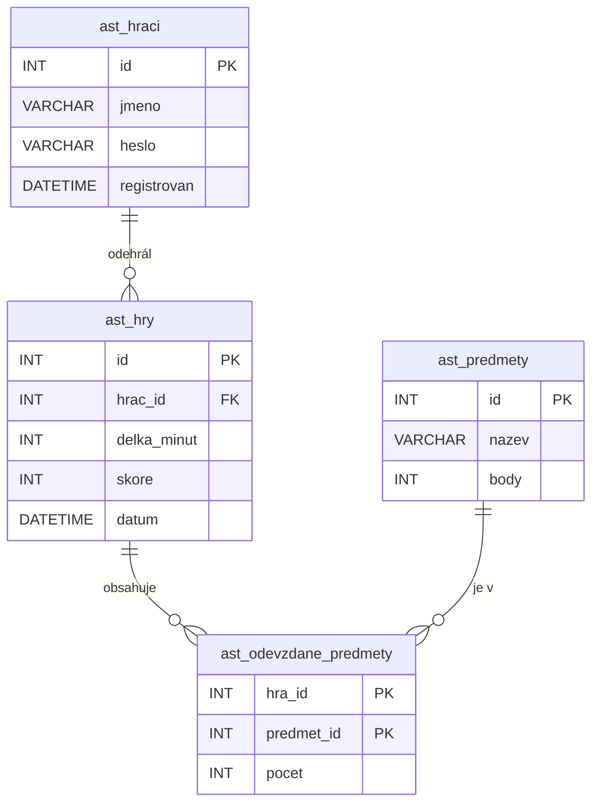

# Maturitni-projekt-Krupka

# Astrallift

Hra v Pythonu (Pygame): těžíš železnou rudu, stavíš stroje a pásy a posíláš výrobky
vesmírným výtahem. Za každý odeslaný předmět jsou body. Web (Flask) má přihlášení,
registraci, výsledky z databáze a tlačítko **Hrát**, které hru spustí.

## Soubory

| Soubor | Co v něm je |
|--------|-------------|
| `hra.py` | celá hra |
| `hudba.wav` | hudba ve hře |
| `pripojeni.py` | údaje k databázi (není na GitHubu) |
| `requirements.txt` | knihovny k instalaci |
| `web/app.py` | celý web + všechno SQL (tabulky, vzorová data, dotazy) |
| `web/templates/` | 4 HTML stránky webu |
| `web/static/styly.css` | vzhled webu |
| `README_hra.md` | návod krok za krokem, jak to spustit ve VS Code |
| `VYSVETLENI_KODU.md` | vysvětlení celého kódu – co dělá která část a proč |

## Spuštění

1. `pip install -r requirements.txt`
2. Vytvoř `pripojeni.py`:
   ```python
   HOST = "dbs.spskladno.cz"
   USER = "student14"
   PASSWORD = "tvoje_heslo"
   DATABASE = "vyuka14"
   ```
3. `python web/app.py` a otevři **http://127.0.0.1:5000**
   (tabulky a vzorová data se vytvoří samy; vzoroví hráči Hrac1, Pepa, Lucka mají heslo `heslo123`)
4. Zaregistruj se a klikni na **▶ Hrát**.

Hra jde spustit i napřímo (`python hra.py`), ale pak se skóre neuloží.

## Manuál

**Menu hry:** Hrát (1 / 3 / 5 minut), Nastavení (hlasitost hudby, celá obrazovka, FPS,
mřížka, nápověda, barva hráče), Ovládání, Web, Konec. Nastavení se ukládá do `volby.txt`.

**Ovládání:**

| Klávesa | Co dělá |
|---------|---------|
| W A S D / šipky | pohyb |
| E | těžit rudu / obsloužit stroj / sebrat věc z pásu / odeslat výtahem |
| 1 / 2 / 3 / 4 | vybrat stavbu: těžič (5 rudy) / pec (10) / lis (15) / pás (1) |
| levé tlačítko myši | postavit (pás jde táhnout) |
| R | otočit směr stavby |
| pravé tlačítko myši | zbourat (ruda i obsah se vrátí) |
| Esc | zrušit výběr / zpět do menu |

Body: ruda 1, ingot 2, plech 4. Počítá se jen to, co odejde výtahem.
Stroj posílá výrobky tam, kam míří jeho šipka; pás je doveze do dalšího stroje nebo do výtahu.

**Chyby:**

| Co vidíš | Co s tím |
|----------|----------|
| „Výsledek se NEPODAŘILO uložit“ | špatně `pripojeni.py` nebo nejsi ve školní síti |
| „Nepřihlášen – skóre se neuloží“ | spusť hru z webu tlačítkem Hrát |
| `No module named ...` | `pip install -r requirements.txt` |
| web bez vzhledu | stránky otevírej přes http://127.0.0.1:5000, ne dvojklikem na .html |

## Kde co změnit

| Chci změnit… | Kde |
|---------------|-----|
| rychlost hráče, velikost okna | `hra.py`, část 1) NASTAVENÍ HRY |
| ceny a rychlost strojů | `hra.py`, slovník `STROJE` |
| body za předměty | `hra.py` (`BODY`) a `web/app.py` (funkce `vytvor_tabulky`) |
| kde je ruda a výtah | `hra.py`, `RUDA_X`… a `VYTAH_X`… |
| texty a tlačítka v menu | `hra.py`, část 8) HLAVNÍ SMYČKA |
| text na webu | `web/templates/…html` |
| barvy webu | `web/static/styly.css` |
| SQL dotazy na výsledky | `web/app.py`, funkce `vysledky` |

## Databáze (ER diagram)



- **1:N** – jeden hráč má hodně her.
- **M:N** – hra obsahuje víc druhů předmětů a předmět je ve víc hrách (spojuje je `ast_odevzdane_predmety`).

**Jak putují data:** web zaregistruje hráče do databáze → tlačítko Hrát zapíše jméno
do `prihlaseny.txt` a spustí `hra.py` → hra na konci uloží výsledek do databáze →
web ho zobrazí ve Výsledcích.
